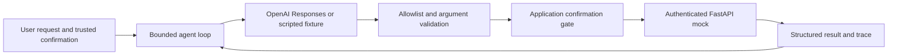

# Onboarding Agent

A bounded tool-calling agent for synthetic appointment onboarding. It checks
availability, requests a booking after application confirmation, and queues a
human handoff. The scheduling service is a local FastAPI mock; no real patients,
appointments, or external booking systems are connected.

## Tools

| Tool | Mock REST endpoint | Boundary |
|---|---|---|
| `check_availability` | `GET /availability` | Read available synthetic slots |
| `book_appointment` | `POST /appointments` | Requires trusted consent, approved slot, and prior availability result |
| `escalate_to_human` | `POST /escalations` | Queues an in-memory ticket using a reason code |



## Run without an API key

Python 3.11+. From the repository root:

```sh
python -m venv .venv
# Windows: .venv\Scripts\Activate.ps1
# Linux/macOS: source .venv/bin/activate
python -m pip install -e '.[test]'
python -m pytest -q
python -m onboarding.demo
python -m onboarding.demo --consent --confirm-slot slot-1
```

The first demo returns `confirmation_required`. The second performs availability
and booking through FastAPI's in-process HTTP test transport. It uses a scripted
model fixture, so it demonstrates orchestration rather than LLM decision quality.

## Optional real model

The adapter follows the official OpenAI
[function calling guide](https://developers.openai.com/api/docs/guides/function-calling).
It sends strict function schemas, preserves output/reasoning items across rounds,
disables parallel tool calls, limits rounds and tool executions, and uses
`store=False`. That setting is not a zero-retention guarantee.

```sh
python -m pip install -e '.[test,openai]'
```

In PowerShell, start the mock API in terminal 1:

```powershell
$env:APPOINTMENT_API_KEY = 'local-demo-key-change-me'
python -m uvicorn onboarding.api:create_app --factory --host 127.0.0.1 --port 8000
```

In terminal 2, configure your own API key and an explicitly selected compatible
Responses model. Do not commit credentials:

```powershell
$env:APPOINTMENT_API_KEY = 'local-demo-key-change-me'
$env:OPENAI_API_KEY = '<your-api-key>'
$env:OPENAI_MODEL = '<your-compatible-model-id>'
python -m onboarding.demo --live --consent --confirm-slot slot-1
```

Live mode sends the supplied message and tool results to OpenAI and may incur
charges. Use synthetic text only. No paid model call is claimed in validation;
the provider request/response contract is checked with a fake SDK client.

## Design and operating limits

- Consent and slot approval come from application-owned `Context`, not model arguments.
- Booking arguments cannot override customer identity or consent. Unknown tools and
  extra argument fields are rejected; tools do not execute arbitrary URLs or code.
- Slot assignment and idempotency are protected by one process-local lock. Repeating
  an API request with its idempotency key returns the same result; changed payloads
  or already occupied slots return 409.
- Each agent run has a fresh booking idempotency key. It is not a durable run store
  and cannot recover in-flight requests across process restarts.
- State is in memory. Run one worker, bind locally, and use only fictional references
  prefixed with `demo-`. This is a portfolio reference, not a production scheduler.
- Free-text model replies remain untrusted. Structured tool results are the source
  of truth for bookings. Prompt instructions alone do not establish medical safety,
  injection resistance, or factual accuracy. No clinical triage is implemented.
- API exceptions are represented by bounded error codes. The demo prints synthetic
  traces; an actual deployment would need durable storage, audit policy, rate limits,
  scoped credentials, and independently evaluated guardrails.

The separate [Healthcare LLM Guardrails](https://github.com/baghirovamalaksima-ui/healthcare-llm-guardrails)
project is unchanged. This repository focuses on tool execution and application
authorization rather than reusing its clinical-request rules.

## Containers

```sh
docker build -t onboarding-agent .
docker run --rm onboarding-agent
```

The default container runs the offline tests as a non-root user. Dependencies use
bounded version ranges; resolve a reviewed lockfile for a deployment.

## Layout

```text
onboarding/api.py     Mock REST service and idempotent booking
onboarding/agent.py   Tool schemas, OpenAI adapter, bounded orchestration
onboarding/demo.py    Offline demonstration and opt-in live CLI
tests/test_agent.py   API, authorization, failure, and protocol checks
```

Created with AI assistance. All data is synthetic. MIT licensed.
